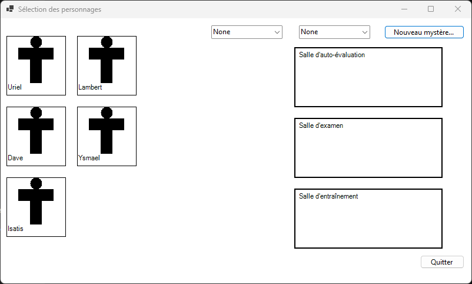
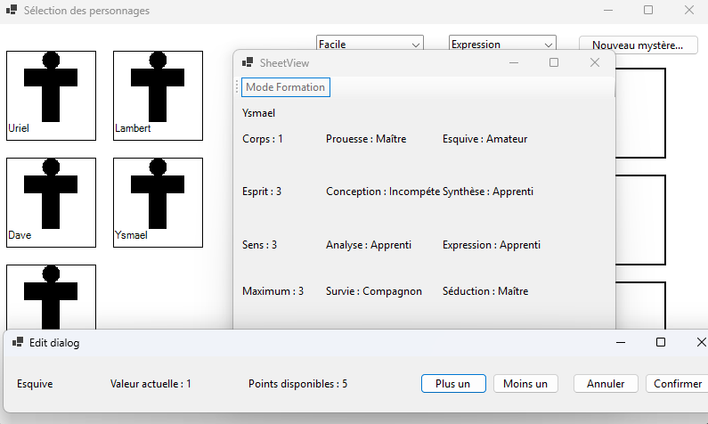
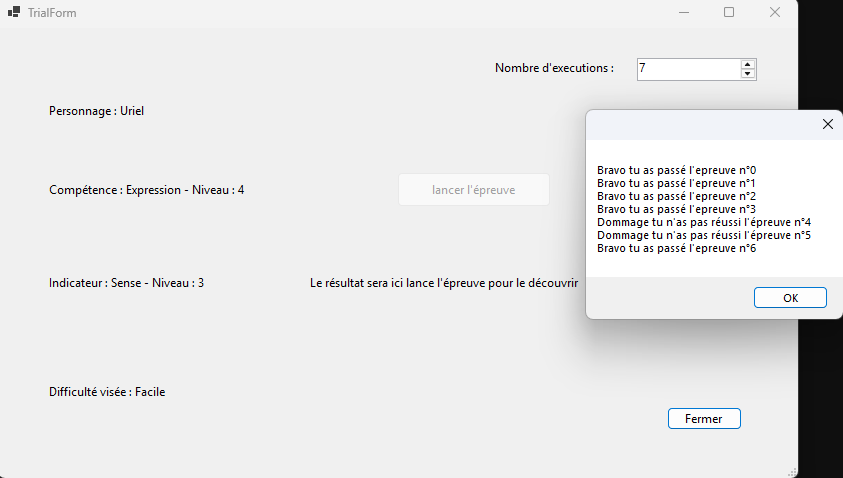

# Butopia RPG Manager

[English Version](README.md)


*Interface principale WinForms affichant la liste des personnages (`Uriel`, `Lambert`, `Dave`, `Ysmael`, `Isatis`), les filtres de difficulté/compétence et les zones d'affectation de salles.*

Butopia RPG Manager est une application de bureau développée en C# avec **.NET 8 (Windows Forms)** conçue pour les maîtres du jeu et les joueurs afin de gérer efficacement les mystères, les personnages, les attributs, les compétences, les épreuves et les feuilles de personnage de jeux de rôle sur table.

---

## Gestion des Personnages


*Modèle d'attributs de personnages orienté objet (`Corps`, `Esprit`, `Sens`, rangs de maîtrise) aux côtés de la boîte de dialogue modale d'allocation de points.*

L'application intègre un modèle de données orienté objet robuste (`MysterySheet`, `Skill`, `Indicator`, `Sphere`) permettant une personnalisation détaillée des personnages et le suivi des attributs.

---

## Simulation d'Épreuves


*Moteur de résolution d'épreuves probabilistes par lots (`TrialForm` avec exécutions multiples et boîte de dialogue de résultats).*

Les maîtres du jeu peuvent simuler des épreuves complexes, tester les probabilités de réussite des compétences et enregistrer les résultats d'entraînement directement au fil de la campagne.

---

## Fonctionnalités

- **Gestion des Personnages** : Créez, sélectionnez et personnalisez des personnages avec leurs attributs, indicateurs et compétences.
- **Feuilles de Mystère** : Suivez la progression des enquêtes et des indices (`MysterySheet`).
- **Épreuves & Entraînement** : Simulez des épreuves, l'entraînement des personnages et les mécaniques de progression (`TrialForm`, `TrainForm`).
- **Préférences & Configuration** : Ajustez dynamiquement les paramètres et règles de l'application.

## Prérequis (Windows)

- **Windows 10 / 11** (ou Windows Server)
- **Kit de développement .NET 8.0 SDK** (ou .NET 8 Desktop Runtime)
- **Visual Studio 2022** (recommandé) ou **VS Code** avec les extensions C#.

## Comment Compiler & Lancer sur Windows

### Utilisation de Visual Studio
1. Ouvrez le fichier solution `ButopiaMysteries.sln` dans Visual Studio 2022.
2. Définissez `ButopiaMysteries` comme projet de démarrage.
3. Appuyez sur `F5` ou cliquez sur **Démarrer** pour compiler et exécuter l'application.

### Utilisation de la CLI .NET
1. Ouvrez l'Invite de commandes ou PowerShell à la racine du projet :
   ```cmd
   cd butopia-rpg-manager/ButopiaMysteries
   dotnet build
   dotnet run
   ```

## Structure du Projet

```text
ButopiaMysteries/
├── GraphicsUserInterface/   # Vues Windows Forms (sélection de personnages, feuilles, épreuves, dialogues)
├── Logic/                   # Logique métier du JDR (feuilles de mystère, épreuves, compétences, règles)
├── Program.cs               # Point d'entrée de l'application
└── ButopiaMysteries.csproj  # Fichier projet .NET 8 Windows Forms
```

---
**Documentation :** Pour les spécifications complètes du projet, veuillez vous référer à [S2.01_2026.pdf](S2.01_2026.pdf).
