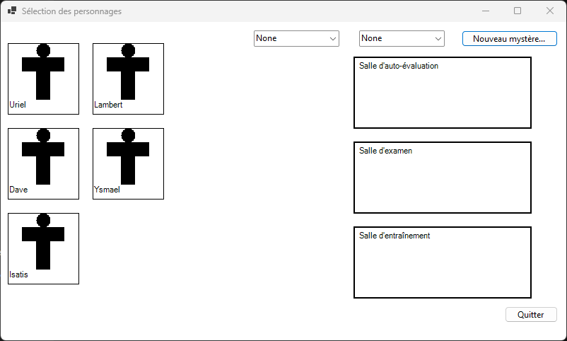
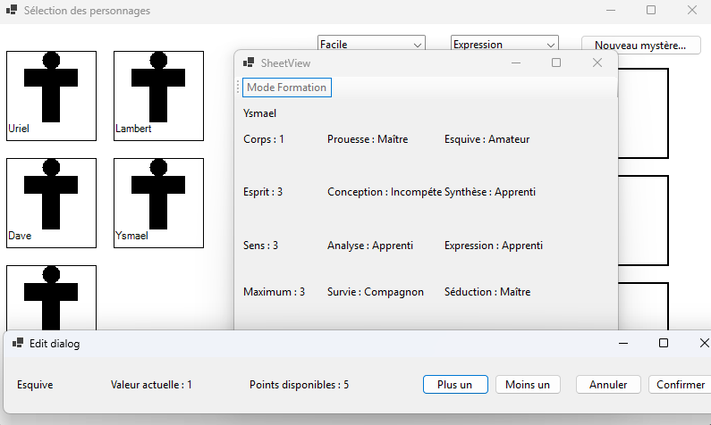
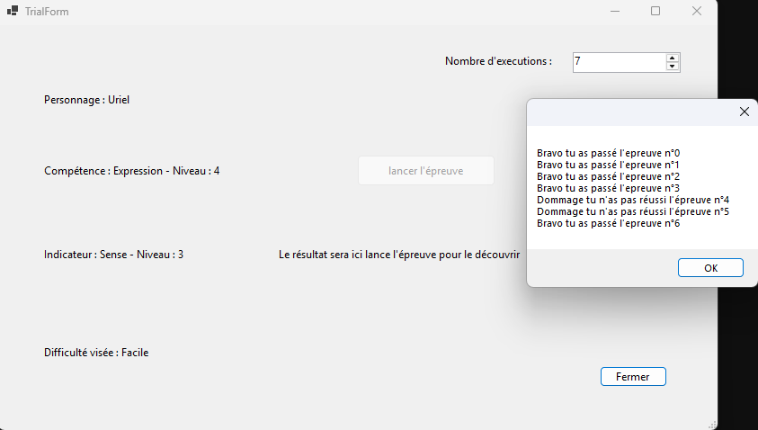

# Butopia RPG Manager

[Version Française](README.fr.md)


*Main WinForms interface displaying the character roster (`Uriel`, `Lambert`, `Dave`, `Ysmael`, `Isatis`), difficulty/skill filters, and room assignment zones.*

Butopia RPG Manager is a desktop application developed with **C# .NET 8 (Windows Forms)** designed for Game Masters and players to manage RPG mysteries, characters, attributes, skills, trials, and character sheets efficiently.

---

## Character Management


*Object-oriented character attribute model (`Corps`, `Esprit`, `Sens`, mastery ranks) alongside the modal point-allocation edit dialog.*

The application features a robust object-oriented data model (`MysterySheet`, `Skill`, `Indicator`, `Sphere`) allowing detailed character customization and attribute tracking.

---

## Trial Simulation


*Batch probabilistic trial resolution engine (`TrialForm` with multi-execution runs and outcome dialog).*

Game Masters can simulate complex character trials, test skill success probabilities, and record training outcomes directly within the campaign flow.

---

## Features

- **Character Management**: Create, select, and customize characters with attributes, indicators, and skills.
- **Mystery Sheets**: Track investigative progress and clues (`MysterySheet`).
- **Trials & Training**: Simulate trials, character training, and progression mechanics (`TrialForm`, `TrainForm`).
- **Preferences & Configuration**: Adjust application settings and rules dynamically.

## Requirements (Windows)

- **Windows 10 / 11** (or Windows Server)
- **.NET 8.0 SDK** (or .NET 8.0 Desktop Runtime)
- **Visual Studio 2022** (recommended) or **VS Code** with C# extensions.

## How to Build & Run on Windows

### Using Visual Studio
1. Open the solution file `ButopiaMysteries.sln` in Visual Studio 2022.
2. Set `ButopiaMysteries` as the Startup Project.
3. Press `F5` or click **Start** to compile and run the application.

### Using .NET CLI
1. Open Command Prompt or PowerShell in the project root:
   ```cmd
   cd butopia-rpg-manager/ButopiaMysteries
   dotnet build
   dotnet run
   ```

## Project Structure

```text
ButopiaMysteries/
├── GraphicsUserInterface/   # Windows Forms views (Character select, Sheet view, Trials, Dialogs)
├── Logic/                   # Core RPG business logic (Mystery sheets, trials, skills, rules)
├── Program.cs               # Application entry point
└── ButopiaMysteries.csproj  # .NET 8 Windows Forms project file
```

---
**Documentation:** For full project specifications, refer to [S2.01_2026.pdf](S2.01_2026.pdf).
